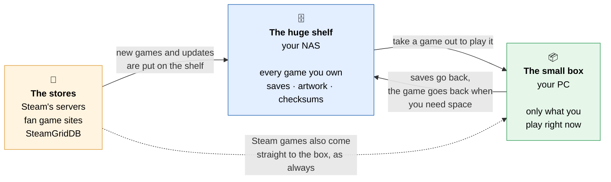
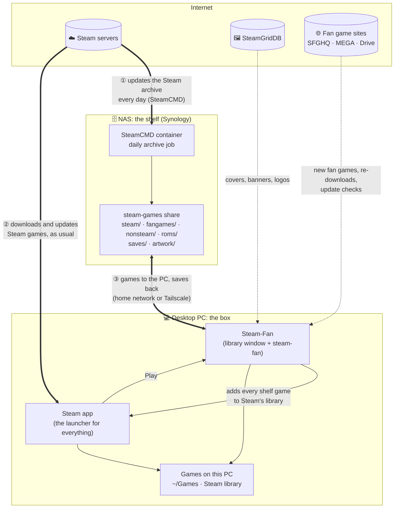
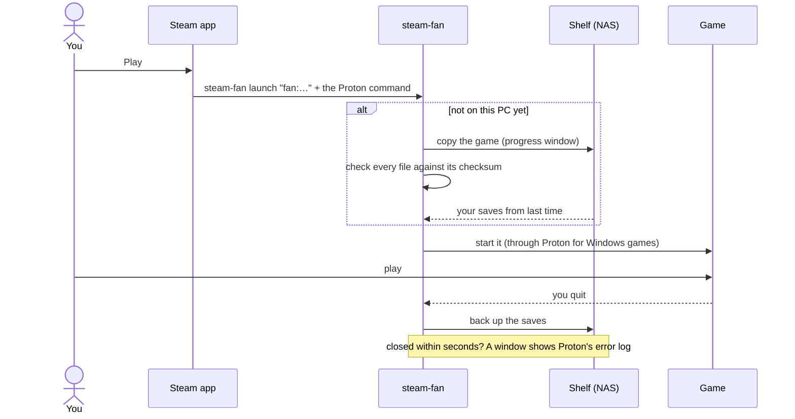
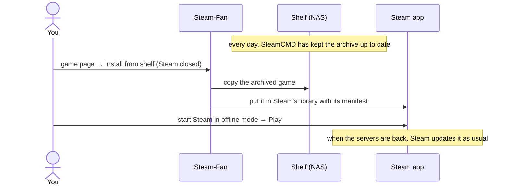
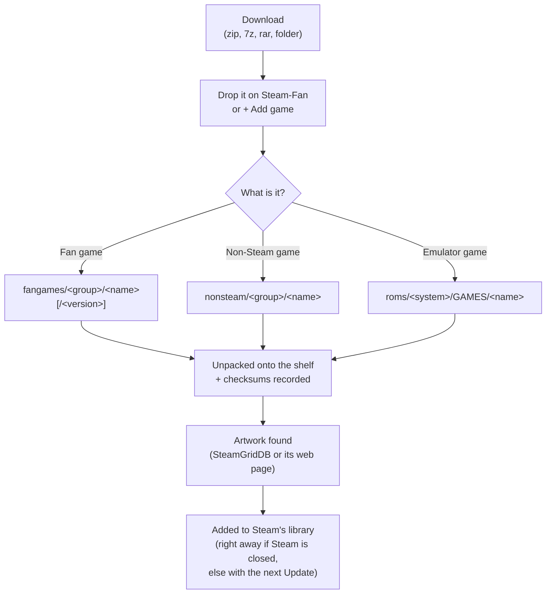
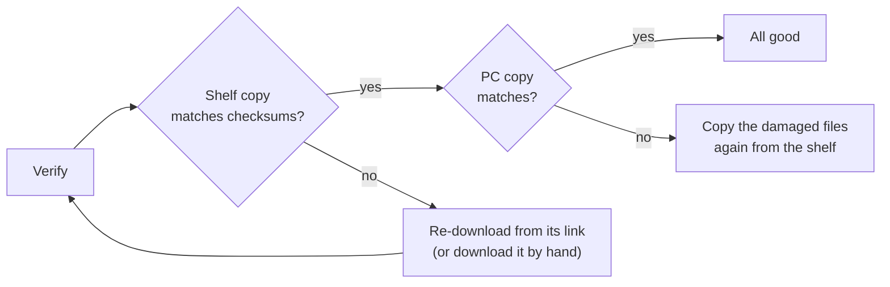

<p align="center"></p>

# Steam-Fan

**Your NAS is the shelf, your PC is the box, Steam is the launcher.**

Every game you have is kept on the shelf: fan games, other non-Steam games,
emulator games, and an offline archive of your Steam games. Steam on your PC
shows all of them. Press Play and the game is copied from the shelf to the PC
first, if it isn't there yet. When you quit, its saves go back to the shelf.

## The idea

Think of a **huge shelf** at home, a **small box** you carry around, and the
**stores** outside where new things come from.



- **The shelf** holds everything, and it's always there for you, even when a store closes (Steam's servers down, a fan game's link gone).
- **The box** only holds what you're playing. Taking a game out of the box loses nothing: it's still on the shelf, and so are its saves.
- **The stores** are where new games and updates come from. They fill the shelf; Steam also delivers its own games straight to the box, as it always has.

## The pieces



| Link | What travels | When |
|---|---|---|
| ① Steam servers → NAS | Every Steam game you own, kept up to date by SteamCMD | Every day at 10:00, by itself |
| ② Steam servers → PC | Steam games you install and play, updated by Steam | As always, when Steam is online |
| ③ NAS ↔ PC | Fan games, non-Steam games and ROMs when you press Play; Steam games when Steam's servers are down; saves back after playing; artwork; games you add or re-download | Whenever you play or add something |

Artwork from SteamGridDB and pictures from a game's web page are saved **on the shelf**, so every PC gets them and they stay even if the site goes away.

## How it works

### Pressing Play on a fan game



### A Steam game while Steam's servers are down



### Adding a new fan game



### Keeping everything healthy



The diagrams show on GitHub and in VS Code (with a Mermaid preview extension).

## Install

```bash
sudo pacman -S --needed webkit2gtk-4.1     # once: the library window needs it
cd ~/Projects/Steam-Fan
./install.sh
```

The script:

- builds two programs and puts them in `~/.local/bin`:
  - `steam-fan-app` is the library window;
  - `steam-fan` is what Steam runs when you press Play, plus the terminal commands;
- adds **Steam-Fan** to the app menu;
- makes the **Steam** menu entry start Steam through Steam-Fan, so new shelf games show up every time Steam starts;
- moves your Steam entries over from the old scripts and removes them (copies are in `legacy/`). Quit Steam first.

## Using it

Open **Steam-Fan** from the app menu.

- **Library:** a cover grid of everything on the shelf, grouped by kind or by group (Sonic, Kirby, wii, ...). Search at the top; the slider at the bottom changes the cover size. "on PC" marks games copied to this PC.
- **A game's page:** a big banner with the logo, then:
  - **Play** (through Steam), **Copy to this PC** / **Remove from PC** (saves go to the shelf first).
  - For Steam games: **Install from shelf** when Steam is down, **Copy to shelf** when this PC has the newer version.
  - **About**: a description, who made it, when, the game's page (SFGHQ, itch.io...), its download link (MEGA, Google Drive, direct) and other links. Press **Edit** to write it.
  - **Files**: **Verify** checks every file against its fingerprint (SHA-256), on the shelf and on this PC, and repairs the PC copy from the shelf. Games added in the app get fingerprints right away; for others the first Verify records them. **Check for update** asks the download link whether it serves a different file now. **Re-download** gets the game again from its link, either replacing a damaged shelf copy or adding the download as a new version. MEGA links need `sudo pacman -S megatools`; links that open a web page (MediaFire, forum pages) have to be downloaded in the browser and added with Add game.
  - **Screenshots**: add as many as you like (button, drop pictures onto the page, or **From a web page**: paste the SFGHQ page and pick its pictures); click one to see it large, arrow keys to flip through.
  - **Move / Rename**: move it to another group (or between fan and non-Steam games), or rename it. Saves, artwork, screenshots, history and the copy on this PC go with it, and Steam keeps the same entry with its play time.
  - **Artwork** tab: cover, banner, logo, icon. For each, **Change** lets you pick from a web page (the game's SFGHQ page), from SteamGridDB, upload a file, drop a picture onto the window, or paste a link. Automatic artwork only uses SteamGridDB results whose name really matches, so a fan game without an entry there gets no picture rather than a wrong one.
- **Add game:** drop a download (zip, 7z, rar), a folder or a ROM onto the window, or press **Add game**. Pick **Fan game / Non-Steam game / Emulator game**, the group or system, and the name. It's unpacked straight onto the shelf, gets artwork, and goes into Steam if Steam is closed.
- **Read shelf** looks for new or changed games, then fills in missing artwork. **Artwork** does only the artwork. **Update Steam library** adds, updates and removes Steam entries. When Steam is running, the button becomes **Restart Steam & update**: it quits Steam, updates the library and starts Steam again (Steam rewrites its library when it quits, so it can't stay open).
- **Settings:** where the shelf is (the NAS, or any folder on this PC), API keys, where games go on this PC, Proton, emulators.

### Artwork

Pictures you pick or upload are saved **on the shelf** in `artwork/<game>/` (with `info.toml` for the About text and `screenshots/`), so every PC gets them and they survive with the games. Pictures you put inside a game's own folder also count: `cover.*`, `folder.*`, `boxart.*`, `hero.*`, `logo.*`, `icon.*`. Missing covers are fetched from SteamGridDB automatically, once per game.

A copy of each picture is kept on this PC, and the pictures are also copied into **Steam's own artwork folder**. Steam's library then shows the same covers, banners, logos and icons. Steam reads new artwork when it starts.

### API keys

Keys live in `~/.config/steam-fan/secrets.env`, readable only by you, not in the settings file:

```text
STEAMGRIDDB_API_KEY=...
STEAM_API_KEY=...        # optional
STEAM_ID=...             # optional
```

Set them in **Settings** or edit the file. An environment variable with the same name wins over the file.

### Terminal commands

```text
steam-fan                    open the library window
steam-fan add <zip|folder|rom> --group "Sonic The Hedgehog" [--kind fan|nonsteam|rom] [--name ...]
steam-fan art [--again]      artwork: copy from the shelf, fetch missing ones, update Steam's
steam-fan verify "Sonic Robo Blast 2"          check files against their fingerprints, repair the PC copy
steam-fan redownload "Sonic Robo Blast 2" [--version "v2.2.14"]   get it again from its download link
steam-fan redownload "Sonic Quantum Collision" --file ~/Downloads/sqc.zip   same, from a file you downloaded
steam-fan sync [--dry-run] [--only "Mario 63"] [--rescan]
steam-fan list [--installed]
steam-fan install "Super Mario 63"
steam-fan remove  "Super Mario 63"
steam-fan archive list | restore <appid> | upload <appid>
steam-fan steam              update the library if Steam is closed, then start Steam
steam-fan launch <id> %command%   what Steam runs when you press Play
```

## The shelf

```text
<shelf>/fangames/<group>/<game>/              Sonic The Hedgehog/Sonic Mania Plus, ...
<shelf>/fangames/<group>/<subgroup>/<game>/
<shelf>/nonsteam/<group>/<game>/              Demos/..., same rules as fangames
<shelf>/roms/<system>/<GAMES>/<game>/         wii, WIIU, Switch: one folder or file per game
<shelf>/steam/<appid>/                        the Steam archive (SteamCMD on the NAS fills it)
<shelf>/saves/                                save backups, never deleted by Steam-Fan
<shelf>/artwork/                              pictures picked or uploaded in the app
```

**Which folder is a game.** A folder is one game when a program sits directly in it. It's also one game when its programs are only in build folders like `bin/` or `x64/`, or when fewer than two subfolders have programs. Otherwise it's a group of games. Folders that hold only zip files or source code are listed as "no program found" and left out of Steam.

**Emulator systems.** Each system folder in `roms/` needs an entry under **Settings > Emulators**, with the file types and the command to start it. The examples cover Dolphin (`wii`), Cemu (`WIIU`) and Ryujinx (`Switch`), using the Linux versions of those emulators. Install them first: `dolphin-emu`, `cemu`, `ryujinx`. Systems without an entry, like `Nintendo 64` and `XBOX 360`, which hold source code right now, are shown in the sidebar and skipped. Wii U update and DLC folders are skipped too. Install those into Cemu itself.

## Where things are on the PC

| What | Where |
|---|---|
| Settings | `~/.config/steam-fan/config.toml` (also holds the optional Steam API key, readable only by you) |
| Library database and history | `~/.local/share/steam-fan/library.db`. Safe to delete: it's rebuilt from the shelf. |
| Artwork | `~/.local/share/steam-fan/art/` (copies from the shelf), `icons/` (icons taken out of each `.exe`) |
| API keys | `~/.config/steam-fan/secrets.env` |
| Fan games | `~/Games/NonSteam/<group>/<game>` (the same place the old scripts used, so games you already have count as installed) |
| Non-Steam games | `~/Games/NonSteam/Non-Steam Games/...` |
| Emulator games | `~/Games/Emulation/<system>/<game>` |
| Steam's files | Steam-Fan backs up `shortcuts.vdf` and `config.vdf` (`*.bak-<date>`) every time it changes them |

## How it's built

```text
crates/core      the library: no window code, all tested
  config.rs        settings file and secrets.env
  shelf.rs         reading the shelf (folder listings only, fast over the network), picking programs and ROM files
  db.rs            SQLite index: what was found, which program starts each game, artwork lookups, history
  library.rs       refresh, install, remove, upload, artwork pass, keeping Steam in step
  artwork.rs       pictures on the shelf and on this PC, SteamGridDB, Steam's grid folder
  import.rs        adding games from zip / 7z / rar / folders
  steam.rs         Steam's library (shortcuts.vdf), Proton per game (config.vdf), manifests
  vdf.rs           Steam's binary and text file formats
  archive.rs       Steam archive: compare versions, install from shelf, copy to shelf
  launch.rs        Play: Proton prefix saves, emulator command, backups
  saves.rs         save backup and restore
  transfer.rs      copying that resumes and skips identical files
  icons.rs         icons from .exe / .ico / .png / Wii U meta
crates/desktop   steam-fan-app: the Tauri window; commands the interface calls, background jobs, art:// pictures
crates/app       steam-fan: Play (with a small progress window), terminal commands
ui/              the interface (Svelte). ui/dist is the built copy the window uses
legacy/          the earlier scripts, the NAS archive script, docs
```

**Changing the interface:** you need Node.js. Run `cd ui && npm install` once. Then:

- **Live editing:** run `npm run dev` in `ui/`, and in another terminal `cargo run -p steam-fan-app --no-default-features`. The window reloads as you edit `ui/src`.
- **When you're done:** run `npm run build`, then `./install.sh`.

Run the tests with `cargo test`.

## Next steps

1. **Shelf service on the NAS.** A small container serves the shelf over HTTP. The box then works through Tailscale from anywhere, with no SMB mount. The Steam archive job (`legacy/nas/archive.sh`) moves into it, with progress visible in the app.
2. **Versions** of one game side by side (Sonic Worlds builds), and keeping games that update themselves (Sonic Robo Blast 2) on the shelf as new versions.
3. Remote: a "wake the PC and start this game" button. Steam Remote Play already streams every library entry, Steam-Fan ones included.
